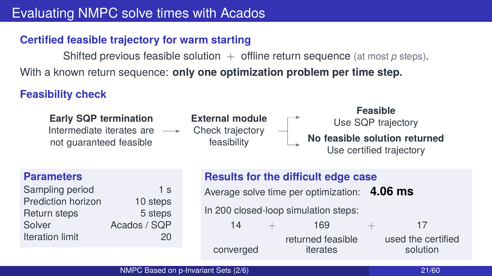
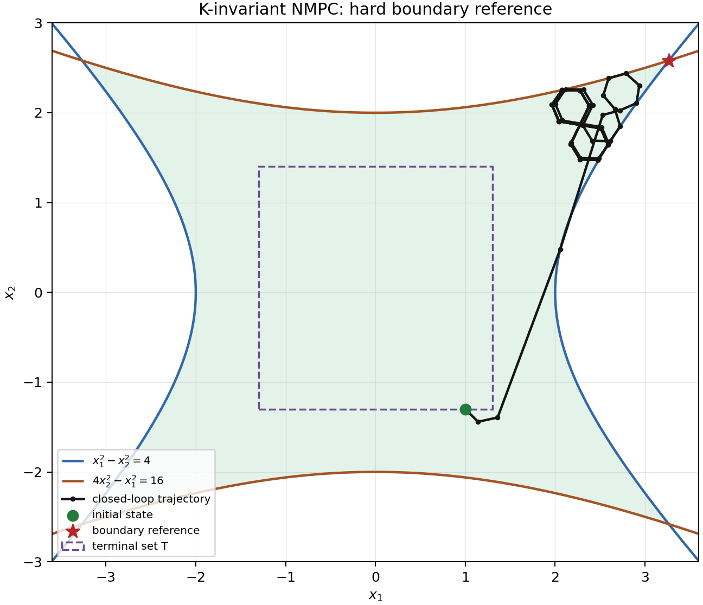

# Fixed-Horizon K-Invariant NMPC

Minimal online controller for a unicycle robot, using CasADi and acados.

## Main files

- `scripts/online_acados.py`: optimization, moving terminal constraint, and fallback.
- `scripts/simulate_hard_reference.py`: closed-loop simulation and trajectory plot.
- `data/offline/paper_k5_lookup.mat`: precomputed safety and terminal-reaching controllers.
- `scripts/run_python.sh`: runs Python in your active environment and configures the acados library path.

## Fixed horizon, moving terminal constraint

In `online_acados.py`, `build_ocp()` fixes the optimization horizon at
`N = PREDICTION_STEPS + K - 1 = 10 + 5 - 1 = 14` control steps.
Safety constraints apply throughout the prediction. The terminal rectangle
is enforced at one selected stage `tau` in `{10, 11, 12, 13, 14}`.

`set_terminal_candidate()` updates each stage's constraint bounds. Only the
selected stage receives the additional terminal bounds; the horizon length
and terminal rectangle stay fixed.

`offline_initial_sequence()` selects the initial terminal stage.
`sliding_initial_sequence()` shifts it back by one step. When it reaches the
lower edge of the window, the offline reaching controller constructs a return
to the terminal set and selects a new stage. The safety controller fills the
sequence to keep its length at 14.

## Solver selection and fallback

`solve_one_online_step()` solves only the preferred terminal-stage branch,
with at most 20 SQP iterations by default, instead of enumerating all five
branches. It first validates the initial sequence as a backup.

`trajectory_feasibility_violation()` rolls out the optimizer's inputs and
checks input, safety, and terminal constraints with tolerance `1e-5`.
A feasible candidate is accepted even without solver convergence. Otherwise,
the validated backup is returned (`acceptance="certified_backup"`). If the
backup itself is invalid, the update raises an error. Cost improvement is
not required for acceptance. Validation uses the supplied discrete model.

## SQP feasibility and fallback illustration

The following slide illustrates the feasibility check and certified-trajectory
fallback, and reports results from a 200-step simulation.



[View the original PDF](results/sqp_infeasible_replacement.pdf).

## Environment and run

Follow [ENVIRONMENT.md](ENVIRONMENT.md) to create the Python environment and
build or reuse acados. With the environment active and `ACADOS_SOURCE_DIR` set,
run these commands from the project folder.

```sh
sh scripts/run_python.sh scripts/check_environment.py
sh scripts/run_python.sh scripts/online_acados.py
sh scripts/run_python.sh scripts/simulate_hard_reference.py --steps 50
```

The commands check the environment, run one control update, and simulate
50 steps to produce a trajectory plot under `results/`.
Generated solver files stay in this project's `.cache/` directory.

## Result plot

`simulate_hard_reference.py` calls `plot_trajectory()` to draw the robot's
closed-loop path, initial state, boundary reference, safety boundaries, and
terminal rectangle. The default output is `results/hard_reference_trajectory.png`.
A 50-step example and its console log are included in `results/`.



To regenerate the figure with a chosen SQP iteration limit and output name:

```sh
sh scripts/run_python.sh scripts/simulate_hard_reference.py \
  --steps 50 --max-sqp-iterations 20 \
  --output results/hard_reference_trajectory.png
```

The log reports completed steps, constraint violation, solve times, and how
often the feasible backup was used. Timing varies between runs.

To share the project, include the scripts, lookup table, documentation, and
example results. Omit `.cache/`, `__pycache__/`, and `.DS_Store`.
